> 2026-10-07 版本提示：本文保留第一期旧基线。知识点目标需求以 [新交付包 v0.9.9](knowledge/review-v0.9.9/README.md) 为准，但仍待模型批准和契约修正；本文相关内容不是当前已冻结实施规范。详见 [契约评审报告](reviews/contract-review-2026-10-07.md)。

# XMUOJ-AI 第一期数据库结构规范

- 文档版本：1.0.0
- 状态：已批准／冻结
- 更新日期：2026-08-10
- 适用后端：Django 3.2、PostgreSQL、现有 XMUOJ 数据库
- 关联规范：[题目批量交付格式](./problem-import-contract-v1.md)、[Agent 工具接口契约](./agent-tool-contract-v1.md)、[学习工作流 OpenAPI](./openapi/learning-api-v1.yaml)、[统一错误码](./api-error-codes-v1.md)

## 1. 目标与边界

本规范冻结第一期所需的数据表、字段语义、关联关系、唯一约束、索引、状态机和数据归属。完成评审后，数据团队、后端、推荐算法和 Agent 开发均以本规范为准。

第一期的验收范围是“冻结数据结构和接口契约”，不以模型、迁移或业务服务已上线为前提。本文所列表均是后续实现的冻结基线：

1. 优先实现：知识点、题目知识点映射、题目导入批次、外部题目交付记录、外部题目稳定绑定、外部标签映射、教学班与教师权限、Agent 运行与审计、错误模式、Agent 反馈。
2. 结构冻结但可延后启用：Elo 掌握度、学习路径、RAG 文档与向量片段、复杂多轮 Agent 会话。

本规范不修改 XMUOJ 既有核心表 `problem`、`problem_tag`、`submission`、`user` 的字段语义。新表通过外键或稳定业务标识引用既有数据。

## 2. 设计原则

### 2.1 兼容现有项目

- Django 模型统一显式设置 `db_table`。
- JSON 字段在当前代码中使用 `utils.models.JSONField`，升级 Django 后再评估迁移到内置 `models.JSONField`。
- `Problem` 使用整数主键，`Submission` 使用文本主键；所有外键类型必须跟随既有模型。
- 时间统一按 UTC 入库，通过 Django 时区机制展示为用户时区。
- 知识点、标签、外部题目均采用软停用或状态流转，避免物理删除破坏历史数据。
- 公开题（`contest_id IS NULL`）的 `Problem._id` 必须具有数据库级部分唯一约束；比赛题继续使用 `(_id, contest_id)` 唯一语义。

### 2.2 Agent 不拥有业务真相

- 知识图谱、Elo、学习路径和 RAG 数据由各自工作流维护。
- Agent 只读取这些模块的已审核结果。
- Agent 不得直接修改 `StudentKnowledgeState`、`LearningPath`、`ProblemKnowledge` 或 `KnowledgeDependency`。
- Agent 只拥有运行日志、工具调用日志、提示状态、对话记录和学生反馈。

### 2.3 可追溯性

所有自动生成或 AI 辅助生成的数据必须记录：

- `source`：数据来源。
- `confidence`：置信度。
- `review_status`：审核状态。
- `created_time`、`updated_time`。
- 可修改业务数据应记录审核人或算法版本。

### 2.4 外键删除策略

- 审计、导入历史、评分历史和 Agent 运行记录的主业务外键默认 `PROTECT`，不得级联删除。
- `CollectedProblem.duplicate_of` 和 `imported_problem` 使用 `SET_NULL`，以保留交付史。
- 纯子记录使用 `CASCADE`：`LearningPathStep -> LearningPath`、`RagChunk -> RagDocument`、`AgentToolCall -> AgentRun`、`AgentMessage -> AgentConversation`。
- 知识点、外部来源绑定和教学班使用软停用；已被引用时不提供物理删除操作。

下表冻结全部外键的 `on_delete`；未在表中单列的同类字段按该行处理，不得使用 Django 默认值猜测：

| 关系 | `on_delete` | 理由 |
|---|---|---|
| KnowledgeDependency 的两个 KnowledgePoint；ProblemKnowledge 的 Problem/KnowledgePoint | `PROTECT` | 保留图结构和审核关系 |
| 业务表的 `created_by`、`reviewed_by`、`granted_by` 且字段允许空 | `SET_NULL` | 保留数据，用户信息可匿名 |
| ProblemImportBatch.uploaded_by；CollectedProblem.batch；ExternalProblemBinding 的 Problem 和首/最近交付记录 | `PROTECT` | 导入审计链不可断裂 |
| CollectedProblem.duplicate_of/imported_problem；ExternalTagMapping.knowledge_point | `SET_NULL` | 保留历史并允许对象停用 |
| TeachingClassTeacher/Student.teaching_class；其 teacher/student/granted_by | `PROTECT` | 班级与成员关系软停用 |
| StudentKnowledgeState、ProblemKnowledgeRating、RatingHistory 的业务外键 | `PROTECT` | Elo 结果和历史可审计 |
| LearningPath.user | `PROTECT` | 路径归属不可丢失 |
| LearningPath.target_knowledge；LearningPathStep.problem | `SET_NULL` | 目标/题目停用后保留路径快照 |
| LearningPathStep.learning_path | `CASCADE` | 纯子记录 |
| LearningPathStep.knowledge_point | `PROTECT` | 学习步骤语义不可丢失 |
| RagChunk.document | `CASCADE` | 纯子记录 |
| AgentRun.user/problem/submission | `PROTECT` | 运行审计链不可断裂 |
| AgentRun.cached_from；ErrorPattern.problem/knowledge_point；AgentConversation.problem | `SET_NULL` | 可选引用失效时保留主记录 |
| AgentToolCall.run；AgentMessage.conversation；AIFeedbackReview.run | `CASCADE` | 不脱离父对象存在 |
| AgentConversation.user；AIFeedbackReview.user | `PROTECT` | 归属与审计不可丢失 |

## 3. 模块关系

```mermaid
erDiagram
    USER ||--o{ STUDENT_KNOWLEDGE_STATE : owns
    USER ||--o{ LEARNING_PATH : owns
    USER ||--o{ AGENT_RUN : starts
    USER ||--o{ AGENT_CONVERSATION : owns
    USER ||--o{ TEACHING_CLASS_TEACHER : teaches
    USER ||--o{ TEACHING_CLASS_STUDENT : enrolls
    TEACHING_CLASS ||--o{ TEACHING_CLASS_TEACHER : grants
    TEACHING_CLASS ||--o{ TEACHING_CLASS_STUDENT : contains

    PROBLEM ||--o{ PROBLEM_KNOWLEDGE : mapped_to
    KNOWLEDGE_POINT ||--o{ PROBLEM_KNOWLEDGE : describes
    KNOWLEDGE_POINT ||--o{ KNOWLEDGE_DEPENDENCY : prerequisite
    KNOWLEDGE_POINT ||--o{ KNOWLEDGE_DEPENDENCY : dependent

    PROBLEM_IMPORT_BATCH ||--o{ COLLECTED_PROBLEM : contains
    PROBLEM o|--o{ COLLECTED_PROBLEM : imported_from
    PROBLEM ||--o{ EXTERNAL_PROBLEM_BINDING : bound_from
    KNOWLEDGE_POINT ||--o{ EXTERNAL_TAG_MAPPING : maps_to

    SUBMISSION ||--o{ RATING_HISTORY : causes
    SUBMISSION ||--o{ AGENT_RUN : analyzed_by
    KNOWLEDGE_POINT ||--o{ STUDENT_KNOWLEDGE_STATE : measured_by
    LEARNING_PATH ||--o{ LEARNING_PATH_STEP : contains

    RAG_DOCUMENT ||--o{ RAG_CHUNK : split_into
    AGENT_RUN ||--o{ AGENT_TOOL_CALL : records
    AGENT_RUN ||--o{ AI_FEEDBACK_REVIEW : receives
    AGENT_CONVERSATION ||--o{ AGENT_MESSAGE : contains
```



## 4. 已有核心表引用

### 4.1 `problem`

沿用现有 `problem.models.Problem`。新模块主要使用：

- `id`：数据库主键。
- `_id`：展示编号。
- `title`、`description`、`input_description`、`output_description`。
- `samples`、`hint`、`source`。
- `time_limit`、`memory_limit`、`languages`、`template`。
- `difficulty`、`tags`、`visible`、`contest_id`。

注意：现有 `Problem.template` 是提交代码模板，不等于标准解法或算法答案，Agent 工具不得将其解释为完整题解。

### 4.2 `submission`

沿用现有 `submission.models.Submission`。Agent 只读取：

- `id`、`problem_id`、`user_id`。
- `code`、`language`、`result`。
- `statistic_info` 中经过过滤的耗时、内存、编译信息。
- `create_time`。

`info` 中的测试点明细不得原样传入模型。

## 5. 知识图谱表

### 5.1 `knowledge_point`

对应 Django 模型 `KnowledgePoint`，表示稳定、可复用的知识点。

| 字段 | 类型 | 空值 | 默认值 | 说明 |
|---|---|---:|---|---|
| `id` | AutoField | 否 | 自动 | 主键 |
| `code` | varchar(64) | 否 | - | 稳定机器标识，例如 `bfs_basic` |
| `name` | varchar(128) | 否 | - | 展示名称，例如“BFS 基础遍历” |
| `normalized_name` | varchar(128) | 否 | - | 规范化名称，用于查重 |
| `description` | text | 否 | `""` | 知识点定义和边界 |
| `category` | varchar(32) | 否 | `algorithm` | `basic`、`data_structure`、`algorithm`、`paradigm`、`mathematics`、`string`、`graph` |
| `level` | smallint | 否 | `1` | 难度/层级，范围 1～5 |
| `status` | varchar(16) | 否 | `active` | `draft`、`active`、`deprecated` |
| `version` | integer | 否 | `1` | 业务版本，每次结构性修改递增 |
| `aliases` | jsonb | 否 | `[]` | 别名列表，仅用于检索和映射 |
| `metadata` | jsonb | 否 | `{}` | 课程章节等扩展信息 |
| `created_by_id` | FK user | 是 | null | 创建人 |
| `created_time` | timestamptz | 否 | now | 创建时间 |
| `updated_time` | timestamptz | 否 | now | 更新时间 |

约束与索引：

- `UNIQUE(code)`。
- `UNIQUE(normalized_name)`。
- `CHECK(level BETWEEN 1 AND 5)`。
- 索引：`(status, category)`、`updated_time`。
- 已被引用的知识点不得物理删除，只能置为 `deprecated`。

### 5.2 `knowledge_dependency`

对应 `KnowledgeDependency`，表示“学习 dependent 前应掌握 prerequisite”。

| 字段 | 类型 | 空值 | 默认值 | 说明 |
|---|---|---:|---|---|
| `id` | AutoField | 否 | 自动 | 主键 |
| `prerequisite_id` | FK knowledge_point | 否 | - | 前置知识点 |
| `dependent_id` | FK knowledge_point | 否 | - | 后继知识点 |
| `relation_type` | varchar(16) | 否 | `required` | `required` 或 `recommended` |
| `weight` | numeric(4,3) | 否 | `1.000` | 依赖强度，0～1 |
| `source` | varchar(16) | 否 | `manual` | `manual`、`import`、`ai` |
| `confidence` | numeric(4,3) | 否 | `1.000` | 置信度，0～1 |
| `review_status` | varchar(16) | 否 | `pending` | `pending`、`approved`、`rejected` |
| `reviewed_by_id` | FK user | 是 | null | 审核人 |
| `created_time` | timestamptz | 否 | now | 创建时间 |
| `updated_time` | timestamptz | 否 | now | 更新时间 |

约束与索引：

- `UNIQUE(prerequisite_id, dependent_id, relation_type)`。
- `CHECK(prerequisite_id <> dependent_id)`。
- `CHECK(weight BETWEEN 0 AND 1)`。
- `CHECK(confidence BETWEEN 0 AND 1)`。
- 索引：`dependent_id`、`prerequisite_id`、`review_status`。
- 防环检测由领域服务在事务内完成；数据库约束只能阻止自环，不能阻止多节点环。

### 5.3 `problem_knowledge`

对应 `ProblemKnowledge`，表示题目与知识点的多对多映射。

| 字段 | 类型 | 空值 | 默认值 | 说明 |
|---|---|---:|---|---|
| `id` | AutoField | 否 | 自动 | 主键 |
| `problem_id` | FK problem | 否 | - | XMUOJ 题目 |
| `knowledge_point_id` | FK knowledge_point | 否 | - | 知识点 |
| `role` | varchar(16) | 否 | `secondary` | `primary`、`secondary`、`prerequisite` |
| `weight` | numeric(4,3) | 否 | `1.000` | 该知识点在题目中的权重 |
| `source` | varchar(16) | 否 | `manual` | `manual`、`import`、`ai` |
| `confidence` | numeric(4,3) | 否 | `1.000` | 映射置信度 |
| `review_status` | varchar(16) | 否 | `pending` | `pending`、`approved`、`rejected` |
| `reviewed_by_id` | FK user | 是 | null | 审核人 |
| `created_time` | timestamptz | 否 | now | 创建时间 |
| `updated_time` | timestamptz | 否 | now | 更新时间 |

约束与索引：

- `UNIQUE(problem_id, knowledge_point_id)`。
- `CHECK(weight > 0 AND weight <= 1)`。
- 每道已发布题至少有一个审核通过的 `primary` 知识点；该规则由服务层校验。
- 索引：`(problem_id, review_status)`、`(knowledge_point_id, role)`。

## 6. 外部题目采集与导入表

### 6.1 `problem_import_batch`

对应 `ProblemImportBatch`，记录一次完整的数据包交付和导入过程。

| 字段 | 类型 | 空值 | 默认值 | 说明 |
|---|---|---:|---|---|
| `id` | UUID | 否 | uuid4 | 内部主键 |
| `batch_key` | varchar(64) | 否 | - | manifest 的 `batch_id`，也是命令和管理 API 对外返回的批次标识 |
| `schema_version` | varchar(16) | 否 | - | 交付格式版本，例如 `1.0.0` |
| `producer` | varchar(100) | 否 | - | 数据包生产者 |
| `source_platforms` | jsonb | 否 | `[]` | 数据来源平台列表 |
| `manifest` | jsonb | 否 | `{}` | 完整 manifest 快照 |
| `archive_sha256` | char(64) | 否 | - | ZIP 文件 SHA-256 |
| `archive_path` | text | 是 | null | 受控存储路径，不返回给普通用户 |
| `status` | varchar(20) | 否 | `uploaded` | 批次状态 |
| `problem_count` | integer | 否 | `0` | manifest 声明题目数 |
| `valid_count` | integer | 否 | `0` | 校验通过数 |
| `warning_count` | integer | 否 | `0` | 警告数 |
| `error_count` | integer | 否 | `0` | 错误数 |
| `imported_count` | integer | 否 | `0` | 成功导入数 |
| `skipped_count` | integer | 否 | `0` | 重复或主动跳过数 |
| `error_summary` | jsonb | 否 | `{}` | 按错误码聚合的统计 |
| `uploaded_by_id` | FK user | 否 | - | 上传人 |
| `created_time` | timestamptz | 否 | now | 创建时间 |
| `validated_time` | timestamptz | 是 | null | 校验完成时间 |
| `committed_time` | timestamptz | 是 | null | 导入完成时间 |

manifest、Management Command 和管理 API 中名为 `batch_id` 的对外字段统一映射到 `batch_key`；内部 UUID `id` 不对数据团队暴露。

批次状态：

```text
uploaded -> validating -> validated -> importing -> imported
                         |              |
                         -> failed      -> partial
uploaded/validated -> cancelled
```

约束与索引：

- `UNIQUE(batch_key)`，同一对外批次标识只能对应一个数据包。
- `UNIQUE(archive_sha256)`，完全相同的数据包不得重复创建。
- `CHECK(problem_count >= 0)`，所有统计字段均非负。
- 索引：`(status, created_time)`、`uploaded_by_id`。

### 6.2 `collected_problem`

对应 `CollectedProblem`，记录外部题目在某一次批次中的交付、校验和导入结果。它是交付历史，不承担全局来源身份唯一性。

| 字段 | 类型 | 空值 | 默认值 | 说明 |
|---|---|---:|---|---|
| `id` | AutoField | 否 | 自动 | 主键 |
| `batch_id` | FK problem_import_batch | 否 | - | 所属批次 |
| `line_number` | integer | 否 | - | 在 `metadata/problems.jsonl` 中的行号，从 1 开始 |
| `source_platform` | varchar(50) | 否 | - | `xmuoj`、`luogu`、`codeforces`、`leetcode` 等 |
| `source_id` | varchar(100) | 否 | - | 来源平台题号 |
| `source_url` | text | 否 | - | 来源页面 |
| `title` | text | 否 | - | 标准化标题 |
| `content_hash` | char(64) | 否 | - | 规范化题面内容 SHA-256 |
| `raw_data` | jsonb | 否 | `{}` | 原始采集结果快照 |
| `standardized_data` | jsonb | 否 | `{}` | 符合交付规范的数据 |
| `validation_errors` | jsonb | 否 | `[]` | 校验错误与警告 |
| `duplicate_of_id` | FK self | 是 | null | 判定为重复时指向已有记录 |
| `review_status` | varchar(16) | 否 | `pending` | `pending`、`approved`、`rejected` |
| `import_status` | varchar(16) | 否 | `pending` | 导入状态 |
| `allocated_test_case_id` | char(32) | 是 | null | commit 前分配的测试目录标识，用于失败补偿和崩溃恢复 |
| `imported_problem_id` | FK problem | 是 | null | 成功导入后的 XMUOJ 题目 |
| `import_error_code` | varchar(64) | 是 | null | 最终导入错误码 |
| `import_error_message` | text | 是 | null | 脱敏错误摘要 |
| `collected_at` | timestamptz | 否 | - | 原始采集时间 |
| `created_time` | timestamptz | 否 | now | 入批次时间 |
| `updated_time` | timestamptz | 否 | now | 更新时间 |

`import_status` 可选值：

- `pending`
- `validated`
- `duplicate`
- `ready`
- `importing`
- `imported`
- `failed`
- `skipped`

约束与索引：

- `UNIQUE(batch_id, line_number)`。
- `UNIQUE(batch_id, source_platform, source_id)`，同一来源题目可以在不同批次重复交付，但同一批次只能出现一次。
- `allocated_test_case_id` 非空时唯一，且必须匹配 `^[1-9a-f][0-9a-f]{31}$`。
- 索引：`(source_platform, source_id)`、`content_hash`、`(batch_id, import_status)`、`imported_problem_id`。
- 多条历史交付记录可以指向同一 `imported_problem_id`；稳定的一对一来源绑定由 `external_problem_binding` 保证。
- `duplicate_of_id` 用于表达交付记录之间的重复判定；跨平台来源最终可以通过不同 `ExternalProblemBinding` 指向同一道 `Problem`。

### 6.3 `external_problem_binding`

对应 `ExternalProblemBinding`，保存外部来源身份与 XMUOJ 题目的稳定绑定。该表承担跨批次幂等，避免把交付历史和当前来源身份混在同一唯一约束中。

| 字段 | 类型 | 空值 | 默认值 | 说明 |
|---|---|---:|---|---|
| `id` | AutoField | 否 | 自动 | 主键 |
| `source_platform` | varchar(50) | 否 | - | 小写稳定平台代码 |
| `source_id` | varchar(100) | 否 | - | 来源平台题号 |
| `problem_id` | FK problem | 否 | - | 已绑定的 XMUOJ 题目 |
| `first_collected_problem_id` | FK collected_problem | 否 | - | 首次建立绑定的交付记录 |
| `latest_collected_problem_id` | FK collected_problem | 否 | - | 最近一次确认该绑定的交付记录 |
| `first_content_hash` | char(64) | 否 | - | 首次成功绑定时的规范题面哈希 |
| `latest_content_hash` | char(64) | 否 | - | 最近一次确认后的规范题面哈希 |
| `reviewed_by_id` | FK user | 是 | null | 最近一次人工改绑或来源更新审核人 |
| `created_time` | timestamptz | 否 | now | 首次绑定时间 |
| `updated_time` | timestamptz | 否 | now | 最近确认或更新绑定时间 |

约束与索引：

- `UNIQUE(source_platform, source_id)`，一个来源身份最多绑定一道 XMUOJ 题目。
- 同一道 `Problem` 可以被多个不同平台的来源身份绑定，用于表达确认后的跨平台同题。
- `source_platform` 入库前转为小写稳定代码；`source_id` 保留来源平台的规范大小写。
- `first_content_hash` 和 `latest_content_hash` 必须匹配 64 位小写 SHA-256。
- 索引：`problem_id`、`latest_content_hash`。
- 两个交付记录外键的 `source_platform/source_id` 必须与本绑定一致，由服务层在事务内校验。
- 已有绑定遇到相同哈希时按重复交付处理；哈希变化时只产生 `source_updated` 待审核事件，不自动覆盖 `Problem` 或更换绑定。
- 删除或改绑必须是管理员审核操作并留下审计记录，普通导入任务无权执行。

### 6.4 `external_tag_mapping`

对应 `ExternalTagMapping`，是 `tag_mapping.csv` 入库后的权威映射。

| 字段 | 类型 | 空值 | 默认值 | 说明 |
|---|---|---:|---|---|
| `id` | AutoField | 否 | 自动 | 主键 |
| `source_platform` | varchar(50) | 否 | - | 来源平台 |
| `source_tag` | varchar(128) | 否 | - | 原始标签 |
| `normalized_source_tag` | varchar(128) | 否 | - | 规范化原始标签 |
| `unified_tag` | varchar(128) | 否 | - | 项目统一标签名称 |
| `knowledge_point_id` | FK knowledge_point | 是 | null | 对应知识点，可暂时为空 |
| `confidence` | numeric(4,3) | 否 | `1.000` | 映射置信度 |
| `status` | varchar(16) | 否 | `active` | `pending`、`active`、`disabled` |
| `created_time` | timestamptz | 否 | now | 创建时间 |
| `updated_time` | timestamptz | 否 | now | 更新时间 |

约束与索引：

- `UNIQUE(source_platform, normalized_source_tag)`。
- `CHECK(confidence BETWEEN 0 AND 1)`。
- 索引：`knowledge_point_id`、`(source_platform, status)`。
- 一个规范化外部标签在同一平台只能指向一个统一标签；候选结果多义时必须保持 `pending` 且 `knowledge_point_id = null`，不得自动选择。

### 6.5 `teaching_class`

对应 `TeachingClass`，是教师查看学生学习数据的唯一授权边界。不把“教师”扩展为全站管理员权限。

| 字段 | 类型 | 空值 | 默认值 | 说明 |
|---|---|---:|---|---|
| `id` | UUID | 否 | uuid4 | 主键 |
| `code` | varchar(64) | 否 | - | 稳定班级标识，例如 `2026-algo-01` |
| `name` | varchar(128) | 否 | - | 展示名称 |
| `course_name` | varchar(128) | 否 | `""` | 课程名称 |
| `term` | varchar(32) | 否 | - | 学期，例如 `2026-fall` |
| `status` | varchar(16) | 否 | `active` | `draft`、`active`、`archived` |
| `created_by_id` | FK user | 否 | - | 创建人，必须为全站管理员 |
| `created_time` | timestamptz | 否 | now | 创建时间 |
| `updated_time` | timestamptz | 否 | now | 更新时间 |

约束：`UNIQUE(code)`；索引：`(term, status)`。已有成员或历史记录的班级只能置为 `archived`。

### 6.6 `teaching_class_teacher`

| 字段 | 类型 | 空值 | 默认值 | 说明 |
|---|---|---:|---|---|
| `id` | AutoField | 否 | 自动 | 主键 |
| `teaching_class_id` | FK teaching_class | 否 | - | 授权班级 |
| `teacher_id` | FK user | 否 | - | 教师用户 |
| `role` | varchar(16) | 否 | `teacher` | `owner`、`teacher`、`assistant` |
| `status` | varchar(16) | 否 | `active` | `active`、`disabled` |
| `granted_by_id` | FK user | 否 | - | 授权人 |
| `created_time` | timestamptz | 否 | now | 创建时间 |
| `updated_time` | timestamptz | 否 | now | 更新时间 |

约束：`UNIQUE(teaching_class_id, teacher_id)`；索引：`(teacher_id, status)`。`owner` 可管理本班成员和教师，`teacher` 可读取本班学习数据，`assistant` 只读且不得导出。教师身份由本表活动授权决定，不依赖既有 `User.admin_type`。

### 6.7 `teaching_class_student`

| 字段 | 类型 | 空值 | 默认值 | 说明 |
|---|---|---:|---|---|
| `id` | AutoField | 否 | 自动 | 主键 |
| `teaching_class_id` | FK teaching_class | 否 | - | 所属班级 |
| `student_id` | FK user | 否 | - | 学生用户 |
| `student_number` | varchar(64) | 是 | null | 班内学号，仅教学用 |
| `status` | varchar(16) | 否 | `active` | `active`、`left` |
| `joined_time` | timestamptz | 否 | now | 入班时间 |
| `left_time` | timestamptz | 是 | null | 离班时间 |

约束：`UNIQUE(teaching_class_id, student_id)`；条件唯一 `UNIQUE(teaching_class_id, student_number) WHERE student_number IS NOT NULL`；索引：`(student_id, status)`。离班使用 `left`，保留历史归属。

### 6.8 教师数据范围规则

- 教师端每个学生查询必须同时满足：教师成员关系为 `active`、班级为 `active`、学生成员关系为 `active`。
- 请求中不接受任意 `teacher_id`；教师始终来自当前认证用户。不满足数据范围时统一返回 `RESOURCE_NOT_FOUND`，避免泄露学生存在性。
- 全站管理员可用显式审计理由跨班查询；该权限不自动下放给班级 `owner`。
- 学生可查看自己的数据，不因是否入班而改变。

## 7. Elo 与学习路径表

以下结构第一期冻结；若算法调研未结束，可先迁移表但不启用自动更新。

### 7.1 `student_knowledge_state`

| 字段 | 类型 | 空值 | 默认值 | 说明 |
|---|---|---:|---|---|
| `id` | AutoField | 否 | 自动 | 主键 |
| `user_id` | FK user | 否 | - | 学生 |
| `knowledge_point_id` | FK knowledge_point | 否 | - | 知识点 |
| `rating` | numeric(10,4) | 否 | `1200.0000` | Elo 掌握度；中间计算使用 Decimal |
| `mastery_level` | varchar(16) | 否 | `unknown` | `unknown`、`weak`、`learning`、`stable`、`mastered` |
| `attempt_count` | integer | 否 | `0` | 参与计算的提交数 |
| `accepted_count` | integer | 否 | `0` | 参与计算的 AC 数 |
| `recent_fail_count` | integer | 否 | `0` | 当前算法时间窗内的失败数 |
| `confidence` | numeric(4,3) | 否 | `0.000` | 掌握度可信度 |
| `algorithm_version` | varchar(32) | 否 | `elo-v1` | 算法版本 |
| `last_submission_time` | timestamptz | 是 | null | 最近相关提交时间 |
| `updated_time` | timestamptz | 否 | now | 更新时间 |

约束：`UNIQUE(user_id, knowledge_point_id)`；`rating >= 0`；计数字段非负；`accepted_count <= attempt_count`；`confidence` 范围 0～1。每次更新在事务内按四位小数 `ROUND_HALF_UP` 入库，不允许实现自行改为整数截断。

### 7.2 `problem_knowledge_rating`

| 字段 | 类型 | 空值 | 默认值 | 说明 |
|---|---|---:|---|---|
| `id` | AutoField | 否 | 自动 | 主键 |
| `problem_id` | FK problem | 否 | - | 题目 |
| `knowledge_point_id` | FK knowledge_point | 否 | - | 知识点 |
| `rating` | numeric(10,4) | 否 | `1200.0000` | 该知识点维度下的题目难度 |
| `source` | varchar(16) | 否 | `difficulty` | `difficulty`、`statistics`、`manual` |
| `attempt_count` | integer | 否 | `0` | 用于估计的提交数 |
| `accepted_count` | integer | 否 | `0` | 用于估计的 AC 数 |
| `confidence` | numeric(4,3) | 否 | `0.000` | 可信度 |
| `algorithm_version` | varchar(32) | 否 | `elo-v1` | 算法版本 |
| `updated_time` | timestamptz | 否 | now | 更新时间 |

约束：`UNIQUE(problem_id, knowledge_point_id)`；计数非负；`accepted_count <= attempt_count`；`rating >= 0`。精度和舍入规则与 `student_knowledge_state.rating` 一致。

### 7.3 `rating_history`

| 字段 | 类型 | 空值 | 默认值 | 说明 |
|---|---|---:|---|---|
| `id` | BigAutoField | 否 | 自动 | 主键 |
| `user_id` | FK user | 否 | - | 学生 |
| `knowledge_point_id` | FK knowledge_point | 否 | - | 知识点 |
| `problem_id` | FK problem | 否 | - | 题目 |
| `submission_id` | FK submission | 否 | - | 触发提交 |
| `old_rating` | numeric(10,4) | 否 | - | 更新前 |
| `new_rating` | numeric(10,4) | 否 | - | 更新后 |
| `delta` | numeric(10,4) | 否 | - | 差值 |
| `problem_rating` | numeric(10,4) | 否 | - | 计算时的题目知识点难度快照 |
| `expected_score` | numeric(7,6) | 否 | - | Elo 期望得分，0～1 |
| `actual_score` | numeric(7,6) | 否 | - | 判题结果映射得分，0～1 |
| `result` | integer | 否 | - | 判题状态快照 |
| `result_weight` | numeric(5,4) | 否 | - | 判题结果权重 |
| `algorithm_version` | varchar(32) | 否 | - | 算法版本 |
| `calculation_detail` | jsonb | 否 | `{}` | 可审计计算参数 |
| `created_time` | timestamptz | 否 | now | 创建时间 |

约束：`UNIQUE(submission_id, knowledge_point_id, algorithm_version)`，保证同一提交幂等更新；`expected_score`、`actual_score`、`result_weight` 均在 0～1 范围。`calculation_detail` 只保存 K 值、题目权重、重复提交衰减因子等扩展参数，不得代替上述显式字段。

### 7.4 `learning_path`

| 字段 | 类型 | 空值 | 默认值 | 说明 |
|---|---|---:|---|---|
| `id` | UUID | 否 | uuid4 | 主键 |
| `user_id` | FK user | 否 | - | 学生 |
| `target_knowledge_id` | FK knowledge_point | 是 | null | 目标知识点 |
| `status` | varchar(16) | 否 | `active` | `active`、`completed`、`expired`、`superseded` |
| `algorithm_version` | varchar(32) | 否 | - | 生成算法版本 |
| `input_snapshot` | jsonb | 否 | `{}` | 生成时学生状态快照 |
| `reason_summary` | jsonb | 否 | `{}` | 结构化推荐依据 |
| `generated_time` | timestamptz | 否 | now | 生成时间 |
| `expires_time` | timestamptz | 是 | null | 失效时间 |

同一学生只能有一条 `active` 主路径，由服务层事务保证。

### 7.5 `learning_path_step`

| 字段 | 类型 | 空值 | 默认值 | 说明 |
|---|---|---:|---|---|
| `id` | AutoField | 否 | 自动 | 主键 |
| `learning_path_id` | FK learning_path | 否 | - | 所属路径 |
| `step_order` | integer | 否 | - | 从 1 开始 |
| `knowledge_point_id` | FK knowledge_point | 否 | - | 本步知识点 |
| `problem_id` | FK problem | 是 | null | 推荐题目 |
| `problem_rating` | numeric(10,4) | 是 | null | 推荐时题目难度快照 |
| `reason_code` | varchar(32) | 否 | - | `prerequisite_weak`、`difficulty_fit` 等 |
| `reason_text` | text | 否 | `""` | 规则工作流生成的简短原因 |
| `status` | varchar(16) | 否 | `pending` | `pending`、`in_progress`、`completed`、`skipped` |

约束：`UNIQUE(learning_path_id, step_order)`；`CHECK(step_order > 0)`。

## 8. RAG 数据表

### 8.1 `rag_document`

| 字段 | 类型 | 空值 | 默认值 | 说明 |
|---|---|---:|---|---|
| `id` | UUID | 否 | uuid4 | 主键 |
| `title` | text | 否 | - | 文档标题 |
| `source_type` | varchar(32) | 否 | - | `problem`、`textbook`、`lecture`、`solution`、`common_error` |
| `source_id` | varchar(100) | 是 | null | 外部或业务对象标识 |
| `source_url` | text | 是 | null | 来源链接 |
| `content` | text | 否 | - | 清洗后的正文 |
| `content_hash` | char(64) | 否 | - | 正文 SHA-256 |
| `access_scope` | varchar(16) | 否 | `student` | `public`、`student`、`teacher`、`admin` |
| `status` | varchar(16) | 否 | `active` | `pending`、`active`、`disabled` |
| `metadata` | jsonb | 否 | `{}` | problem、knowledge、章节等过滤条件 |
| `created_time` | timestamptz | 否 | now | 创建时间 |
| `updated_time` | timestamptz | 否 | now | 更新时间 |

约束：`UNIQUE(source_type, source_id, content_hash)`；索引：`source_type`、`status`、GIN(`metadata`)。

### 8.2 `rag_chunk`

| 字段 | 类型 | 空值 | 默认值 | 说明 |
|---|---|---:|---|---|
| `id` | UUID | 否 | uuid4 | 主键 |
| `document_id` | FK rag_document | 否 | - | 原文档 |
| `chunk_index` | integer | 否 | - | 从 0 开始 |
| `content` | text | 否 | - | 文本片段 |
| `content_hash` | char(64) | 否 | - | 片段 SHA-256 |
| `token_count` | integer | 否 | `0` | 使用指定分词器计算 |
| `metadata` | jsonb | 否 | `{}` | 过滤字段 |
| `embedding_id` | varchar(200) | 是 | null | 向量库中的稳定标识 |
| `embedding_model` | varchar(100) | 是 | null | 向量模型 |
| `embedding_version` | varchar(32) | 是 | null | 向量版本 |
| `created_time` | timestamptz | 否 | now | 创建时间 |

约束：`UNIQUE(document_id, chunk_index)`；`UNIQUE(embedding_id)`（允许 null）；索引：GIN(`metadata`)。

向量可以放在 pgvector、FAISS 或 Chroma；无论选择何种实现，PostgreSQL 中必须保存 `embedding_id`、模型和版本，以便重建和审计。

## 9. Agent 数据表

### 9.1 `agent_run`

表示一次用户可感知的 Agent 调用。

| 字段 | 类型 | 空值 | 默认值 | 说明 |
|---|---|---:|---|---|
| `id` | UUID | 否 | uuid4 | `run_id` |
| `user_id` | FK user | 否 | - | 发起用户，始终来自认证上下文 |
| `service_type` | varchar(40) | 否 | - | Agent 服务类型 |
| `problem_id` | FK problem | 是 | null | 关联题目 |
| `submission_id` | FK submission | 是 | null | 关联提交 |
| `status` | varchar(16) | 否 | `queued` | 运行状态 |
| `idempotency_key` | varchar(100) | 是 | null | 客户端幂等键 |
| `input_hash` | char(64) | 否 | - | 规范化输入哈希 |
| `input_payload` | jsonb | 否 | `{}` | 脱敏输入快照 |
| `output_payload` | jsonb | 是 | null | 结构化最终输出 |
| `provider` | varchar(50) | 是 | null | 模型服务商 |
| `model_name` | varchar(100) | 是 | null | 模型名称 |
| `prompt_version` | varchar(32) | 否 | - | Prompt 版本 |
| `input_tokens` | integer | 否 | `0` | 输入 token |
| `output_tokens` | integer | 否 | `0` | 输出 token |
| `tool_call_count` | integer | 否 | `0` | 工具调用次数 |
| `latency_ms` | integer | 是 | null | 总耗时 |
| `safety_status` | varchar(16) | 否 | `pending` | `pending`、`passed`、`blocked`、`redacted` |
| `error_code` | varchar(64) | 是 | null | 统一错误码 |
| `error_message` | text | 是 | null | 对用户安全的错误摘要 |
| `cached_from_id` | FK self | 是 | null | 缓存来源 |
| `created_time` | timestamptz | 否 | now | 创建时间 |
| `started_time` | timestamptz | 是 | null | 开始时间 |
| `finished_time` | timestamptz | 是 | null | 完成时间 |

`service_type`：

- `submission_feedback`
- `code_explanation`
- `socratic_hint`
- `learning_path_explanation`

`status`：

```text
queued -> running -> succeeded
                 -> failed
                 -> blocked
queued/running -> cancelled
```

约束与索引：

- `UNIQUE(user_id, idempotency_key)`，`idempotency_key` 为空时不参与冲突。
- 索引：`(user_id, created_time)`、`(status, created_time)`、`submission_id`、`input_hash`。
- `submission_feedback`、`code_explanation` 必须具有 `submission_id`；由 serializer 和服务层校验。

### 9.2 `agent_tool_call`

| 字段 | 类型 | 空值 | 默认值 | 说明 |
|---|---|---:|---|---|
| `id` | BigAutoField | 否 | 自动 | 主键 |
| `run_id` | FK agent_run | 否 | - | 所属运行 |
| `sequence` | integer | 否 | - | 调用顺序，从 1 开始 |
| `tool_name` | varchar(64) | 否 | - | 工具名 |
| `tool_version` | varchar(16) | 否 | `1.0` | 契约版本 |
| `arguments` | jsonb | 否 | `{}` | 已脱敏参数 |
| `result_summary` | jsonb | 否 | `{}` | 截断、脱敏后的结果摘要 |
| `status` | varchar(16) | 否 | `running` | `running`、`succeeded`、`failed`、`denied` |
| `duration_ms` | integer | 是 | null | 调用耗时 |
| `error_code` | varchar(64) | 是 | null | 工具错误码 |
| `created_time` | timestamptz | 否 | now | 创建时间 |

约束：`UNIQUE(run_id, sequence)`；索引：`tool_name`、`error_code`。

### 9.3 `error_pattern`

一期为高频题手工维护的错误模式库。

| 字段 | 类型 | 空值 | 默认值 | 说明 |
|---|---|---:|---|---|
| `id` | AutoField | 否 | 自动 | 主键 |
| `code` | varchar(64) | 否 | - | 稳定错误模式代码 |
| `problem_id` | FK problem | 是 | null | 题目级错误模式 |
| `knowledge_point_id` | FK knowledge_point | 是 | null | 知识点级错误模式 |
| `verdict` | varchar(20) | 否 | - | `WA`、`TLE`、`RE`、`CE` 等 |
| `cause_short` | text | 否 | - | 简短原因 |
| `cause_detail` | text | 否 | - | 内部详细说明，不一定全部返回学生 |
| `fix_direction` | text | 否 | - | 不含完整答案的检查方向 |
| `retrieval_text` | text | 否 | `""` | 用于检索的规范文本 |
| `priority` | smallint | 否 | `100` | 数值越小越优先 |
| `review_status` | varchar(16) | 否 | `pending` | `pending`、`approved`、`rejected` |
| `embedding_id` | varchar(200) | 是 | null | 可选向量标识 |
| `created_by_id` | FK user | 是 | null | 创建人 |
| `reviewed_by_id` | FK user | 是 | null | 审核人 |
| `created_time` | timestamptz | 否 | now | 创建时间 |
| `updated_time` | timestamptz | 否 | now | 更新时间 |

约束：`UNIQUE(code)`；`problem_id` 和 `knowledge_point_id` 至少一个非空；索引：`(problem_id, verdict, review_status)`。

### 9.4 `agent_conversation`

| 字段 | 类型 | 空值 | 默认值 | 说明 |
|---|---|---:|---|---|
| `id` | UUID | 否 | uuid4 | 会话 ID |
| `user_id` | FK user | 否 | - | 用户 |
| `problem_id` | FK problem | 是 | null | 关联题目 |
| `service_type` | varchar(40) | 否 | - | 服务类型 |
| `status` | varchar(16) | 否 | `active` | `active`、`closed`、`expired` |
| `current_hint_level` | smallint | 否 | `0` | 0～3 |
| `first_opened_time` | timestamptz | 否 | now | 打开题目/会话时间 |
| `hint_available_time` | timestamptz | 是 | null | 思考倒计时结束时间 |
| `last_active_time` | timestamptz | 否 | now | 最近活动时间 |

约束：`CHECK(current_hint_level BETWEEN 0 AND 3)`；索引：`(user_id, problem_id, status)`。

### 9.5 `agent_message`

| 字段 | 类型 | 空值 | 默认值 | 说明 |
|---|---|---:|---|---|
| `id` | BigAutoField | 否 | 自动 | 主键 |
| `conversation_id` | FK agent_conversation | 否 | - | 会话 |
| `sequence` | integer | 否 | - | 消息序号 |
| `role` | varchar(16) | 否 | - | `user`、`assistant`、`system_event` |
| `content` | text | 否 | - | 消息正文 |
| `metadata` | jsonb | 否 | `{}` | run_id、hint_level、安全标记等 |
| `token_count` | integer | 否 | `0` | token 数 |
| `created_time` | timestamptz | 否 | now | 创建时间 |

约束：`UNIQUE(conversation_id, sequence)`。

### 9.6 `ai_feedback_review`

| 字段 | 类型 | 空值 | 默认值 | 说明 |
|---|---|---:|---|---|
| `id` | AutoField | 否 | 自动 | 主键 |
| `run_id` | FK agent_run | 否 | - | 被评价运行 |
| `user_id` | FK user | 否 | - | 评价用户 |
| `rating` | varchar(24) | 否 | - | `helpful`、`too_long`、`too_hard`、`need_simpler`、`incorrect` |
| `comment` | text | 否 | `""` | 可选补充意见 |
| `created_time` | timestamptz | 否 | now | 创建时间 |

约束：`UNIQUE(run_id, user_id)`。

## 10. 数据归属与写权限

| 数据 | 权威写入方 | Agent 权限 |
|---|---|---|
| KnowledgePoint / Dependency | 知识图谱工作流、教师审核 | 只读 |
| ProblemKnowledge | 题目映射工作流、教师审核 | 只读 |
| CollectedProblem / ImportBatch / ExternalProblemBinding | 题目导入工作流、管理员审核 | 不可调用 |
| TeachingClass / Teacher / Student membership | 全站管理员、班级 owner（受限） | 只读当前用户已授权范围 |
| StudentKnowledgeState / RatingHistory | Elo 工作流 | 只读 |
| LearningPath / Step | 推荐工作流 | 只读 |
| RagDocument / RagChunk | RAG 入库工作流 | 仅通过检索工具读取 |
| AgentRun / ToolCall | Agent Runtime | 写入 |
| ErrorPattern | 教师/数据人员审核 | 只读 |
| Conversation / Message | Agent Runtime | 受控写入 |
| AIFeedbackReview | 当前登录用户 | 仅创建/更新自己的评价 |

## 11. 数据保留与隐私

- `AgentToolCall.arguments` 不记录密码、Cookie、AppKey、隐藏测试点和完整标准代码。
- 学生代码默认保存在既有 `submission` 表；`AgentRun.input_payload` 只保存代码哈希、语言和必要摘要，不重复保存完整代码。
- Agent 输出和对话建议保留 180 天，之后按学校数据政策归档或删除。
- `AgentRun`、`AgentToolCall`、`RatingHistory` 属于审计数据，禁止普通用户修改。
- 用户注销不物理删除被审计数据引用的 `user` 行；应停用账号并匿名化可识别字段。Agent 会话和反馈按保留期删除或匿名化，评分历史是否匿名保留由学校数据政策决定。

## 12. 迁移顺序

建议按以下 Django migration 顺序实施：

1. `knowledge_point`。
2. `knowledge_dependency`、`problem_knowledge`、`external_tag_mapping`。
3. `problem_import_batch`、`collected_problem`、`external_problem_binding`。
4. `teaching_class`、`teaching_class_teacher`、`teaching_class_student`。
5. `agent_run`、`agent_tool_call`、`error_pattern`、`agent_conversation`、`agent_message`、`ai_feedback_review`。
6. `rag_document`、`rag_chunk`。
7. `student_knowledge_state`、`problem_knowledge_rating`、`rating_history`。
8. `learning_path`、`learning_path_step`。

迁移要求：

- 所有唯一约束和检查约束必须由自动化测试覆盖。
- 初始迁移不批量修改现有 `Problem.tags`。
- BFS/DFS 初始知识点和前置关系通过独立 seed command 写入，不写进 schema migration。
- 上线前使用现有数据库快照执行迁移和回滚演练。

## 13. 验收条件

第一期文档冻结必须满足：字段、枚举、约束、索引、删除策略和权限边界无待定项；Schema/OpenAPI 可被机器解析；文档变更遵守[契约变更流程](./contract-change-policy-v1.md)。

进入实现验收时还必须满足：

- 本文冻结的所有模型能成功迁移和回滚。
- 同一来源题号在不同批次重复交付时能保留历史记录，但不会产生两道题。
- 同一批次不能包含重复来源键，同一来源键不能绑定到两道不同题目。
- 导入失败或崩溃恢复后，`allocated_test_case_id` 对应目录要么被 `Problem` 引用，要么被安全清理。
- 同一提交不会重复更新同一知识点评分。
- Agent 运行能追溯到用户、题目/提交、Prompt 版本和全部工具调用。
- 普通用户无法读取其他用户的 AgentRun、Submission 或 Conversation。
- 教师只能读取活动教学班中活动成员的数据，离班、停用或跨班访问被拒绝并留下审计信息。
- 知识点依赖拒绝自环，服务层拒绝多节点环。
- 未审核的映射、错误模式和 RAG 文档不会进入学生端 Agent 上下文。
