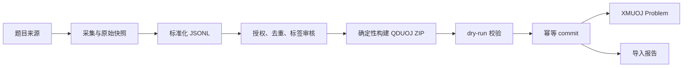

> 2026-10-07 版本提示：本文保留第一期旧基线。知识点目标需求以 [新交付包 v0.9.9](knowledge/review-v0.9.9/README.md) 为准，但仍待模型批准和契约修正；本文相关内容不是当前已冻结实施规范。详见 [契约评审报告](reviews/contract-review-2026-10-07.md)。

# XMUOJ-AI 题目批量交付与导入契约

- 契约版本：1.0.0
- 状态：已批准／冻结
- 更新日期：2026-08-10
- 交付方向：数据团队 → XMUOJ 后端
- 机器契约：[QDUOJ 题目](./schemas/qduoj-problem-v1.schema.json)、[批次 manifest](./schemas/problem-batch-manifest-v1.schema.json)、[标准化记录](./schemas/problem-import-v1.schema.json)、[测试 manifest](./schemas/problem-testcase-manifest-v1.schema.json)、[导入报告](./schemas/problem-import-report-v1.schema.json)
- 管理 API：[problem-import-api-v1.yaml](./openapi/problem-import-api-v1.yaml)
- 黄金包：[problem-batch-example.zip](./examples/problem-batch-example.zip)

## 1. 冻结结论

第一期按《第一期讨论》要求，正式后端交付形式是 **QDUOJ-compatible ZIP**，而不是 JSONL 直接入库。两层数据边界如下：

1. **采集与审计中间层**：标准化 JSONL，保存来源、标签、知识点候选、授权信息和内容哈希。
2. **后端正式交付层**：QDUOJ-compatible ZIP，数字目录内使用现有 QDUOJ `problem.json + testcase/` 格式；根目录扩展 manifest 和 AI 元数据。

JSONL 不得直接调用现有 OJ 导入端点。若未来要改为 JSONL 直接入库，必须升级本契约的主版本并获得 Leader 批准。

## 2. 数据流



## 3. ZIP 格式

### 3.1 目录

```text
xmuoj-problem-batch-{batch_id}.zip
├── manifest.json
├── tag_mapping.csv
├── metadata/
│   ├── problems.jsonl
│   └── raw/
│       └── {problem_key}.json
├── 1/
│   ├── problem.json
│   └── testcase/
│       ├── 1.in
│       ├── 1.out
│       └── ...
└── 2/
    └── ...
```

- 可导入题的目录必须是从 `1` 开始的连续十进制整数，与 manifest `problems[].directory` 一致。
- `manifest.json`、`metadata/problems.jsonl`、`tag_mapping.csv` 为必须文件。
- `metadata/raw/` 仅用于审计，不进入题面或 Agent 上下文。
- `judge_data.status != ready` 的记录仅保留在 metadata，`directory` 为 `null`，不得生成可见、可判题的 `Problem`。
- ZIP 为 UTF-8、LF、禁止加密；路径只使用 `/`，禁止绝对路径、`..`、符号链接和可执行文件。

### 3.2 规模限制

| 入口 | 题目数 | ZIP 总大小 | 用途 |
|---|---:|---:|---|
| Web API | 500 | 256 MiB | 常规批次 |
| Management Command | 5000 | 2 GiB | 受控运维环境的超大批次 |

共同限制：JSONL 单行 2 MiB；单个测试输入或输出 64 MiB；单题测试数据 512 MiB；单题样例 20 组；知识点候选 20 个。

## 4. `manifest.json`

manifest 必须通过 `problem-batch-manifest-v1.schema.json`。核心结构：

```json
{
  "format": "xmuoj-qduoj-batch",
  "schema_version": "1.0.0",
  "batch_id": "20260809-bfs-dfs-001",
  "generated_at": "2026-08-09T10:00:00Z",
  "producer": {"name": "xmuoj-data-pipeline", "version": "0.1.0"},
  "source_platforms": ["luogu"],
  "problem_count": 1,
  "importable_count": 1,
  "problems": [
    {
      "problem_key": "luogu_P1001",
      "metadata_line": 1,
      "directory": "1",
      "delivery_status": "ready",
      "metadata_path": "metadata/problems.jsonl"
    }
  ],
  "files": []
}
```

- `problem_count` 等于 metadata 有效行数；`importable_count` 等于 `directory != null` 的记录数。
- `problem_key` 在批次内唯一，只允许 `[A-Za-z0-9._-]`，长度 1～150。
- `files` 列出除 manifest 自身外的每个常规文件，包含 `path`、`size_bytes`、`sha256`和 `media_type`。
- 后端必须重算大小和 SHA-256，拒绝未声明文件、缺失文件和哈希不一致。manifest 自身不放入 `files`，避免自引用哈希。

## 5. 标准化 JSONL 中间层

`metadata/problems.jsonl` 每个非空行是一个完整 JSON 对象，通过 `problem-import-v1.schema.json`。Leader 标准字段保持必填，包括：

- 来源：`source_platform`、`source_id`、`source_url`、`collected_at`。
- 题面：`title`、`title_cn`、`description_html`、`input_description_html`、`output_description_html`、`samples`。
- 特征：`difficulty_original`、`difficulty_unified`、`initial_problem_rating`、`tags_original`、`tags_unified`、`knowledge_candidates`。
- 限制：`time_limit_ms`、`memory_limit_mb`。
- 审核：`duplicate_of`、`review_status`。

后端增强字段：`problem_key`、`hint_html`、`rule_type`、`allowed_languages`、`judge_data`、`raw_data_path`、`content_hash`、`provenance`。构建前的独立中间目录可使用 `raw/{problem_key}.json` 和 `testcases/{problem_key}/manifest.json`；构建器必须把原始快照重写到 `metadata/raw/`，并用批次 manifest 的 `delivery_status/directory` 代替中间层 `judge_data` 引用，避免正式 ZIP 中出现悬空路径。

稳定来源键是 `(source_platform, source_id)`。同一批次内唯一；不同批次可重复交付，但通过 `ExternalProblemBinding` 只绑定一道 XMUOJ 题。

`content_hash` 对 `title_cn or title`、题面、输入输出说明和样例进行 Unicode NFC、可见文本化、空白折叠和紧凑 JSON 后计算。后端始终重算，不一致返回 `IMPORT_CONTENT_HASH_MISMATCH`。

## 6. QDUOJ `problem.json`

每个可导入记录都必须生成一个符合 `qduoj-problem-v1.schema.json` 的 `{directory}/problem.json`。它与现有 `ImportProblemSerializer` 一致：

| JSONL | QDUOJ `problem.json` | 规则 |
|---|---|---|
| 来源键 | `display_id` | 按 6.1 生成 |
| `title_cn`, `title` | `title` | 非空中文标题优先 |
| 题面三部分 | `description/input_description/output_description` | `{format: "html", value: "..."}` |
| `hint_html` | `hint` | `{format: "html", value: ""}` 为缺省 |
| `samples` | `samples` | 保序，UTF-8/LF |
| `time_limit_ms` | `time_limit` | 毫秒 |
| `memory_limit_mb` | `memory_limit` | MiB |
| `rule_type` | `rule_type` | `ACM` 或 `OI` |
| `tags_unified` | `tags` | 只绑定已有标签，不自动建标签 |
| `source_url` | `source` | 规范化 URL |
| 无 | `template`, `answers` | `{}` 和 `[]` |
| 固定 | `spj`, `allow_public_test_case_download` | `null`, `false` |

`allowed_languages` 保留在 metadata 供审核；现有 QDUOJ `ImportProblemSerializer` 没有该字段，导入时 `Problem.languages` 按 `SysOptions.language_names` 设置。若需按题限制语言，必须先升级导入序列化器与本契约，不得在 `problem.json` 中夹带未声明字段。

`test_case_score` 按 manifest 顺序生成 `{score,input_name,output_name}`。ACM 题每个测试点使用 `score=100`，符合现有序列化器 `score >= 1` 的要求；OI 题使用声明分数，总分必须等于测试 manifest `total_score`。

### 6.1 `display_id` 与并发唯一

```text
base = UPPER(platform_alias) + "-" + sanitized_source_id
```

别名至少固定 `luogu -> LUOGU`、`codeforces -> CF`、`leetcode -> LC`。来源题号只保留 ASCII 字母、数字、`_`、`-`；空结果用 `ID-` 加来源键 SHA-256 前 12 位。长度超过 24 时使用 `base[0:15] + "-" + sha256(source_key)[0:8]`。

- 公开题在数据库上必须建立 `UNIQUE(_id) WHERE contest_id IS NULL`，不仅依赖应用层查重。
- commit 以来源键为幂等键，在事务中锁定或创建 `ExternalProblemBinding`；唯一约束冲突后重读绑定。
- 已有 `_id` 属于相同来源键时按重复交付处理；属于其他来源键时返回 `IMPORT_DISPLAY_ID_CONFLICT`，不追加随机后缀。

## 7. 测试数据

构建前的 JSONL 中间层可使用 `problem-testcase-manifest-v1.schema.json` 引用测试文件。构建后：

- manifest 数组顺序是权威顺序，文件重命名为连续的 `1.in/1.out`、`2.in/2.out`。
- 构建器和后端都要重算 SHA-256，非 SPJ 题必须同时有输入和输出。
- 第一期不自动执行或编译数据包内 SPJ；`spj=true` 保持 `needs_review`。
- 导入后端依据实际文件重新生成 XMUOJ `info`，不信任外部 `info`。

## 8. 标签和知识点

`tag_mapping.csv` 表头固定为：

```csv
source_platform,source_tag,unified_tag,knowledge_code,confidence
```

`(source_platform, normalized_source_tag)` 在文件和数据库内均唯一。冲突或多义时保持 `pending`，不覆盖已有映射。`tags_unified` 只绑定已有 active 标签。2026-10-07 工作修订：`knowledge_candidates` 仅为名称字符串，缺少 role/weight，完整保留在采集记录中并产生 warning；不生成 pending/rejected 的 `ProblemKnowledge`，也不拼造不完整的 `KnowledgeMappingBatch`。人工补齐后进入知识模块的候选提交与审核流程；正式 `ProblemKnowledge` 只保存 approved 集合。

## 9. 上传、查询与 commit

管理 API 以 `problem-import-api-v1.yaml` 为权威契约，核心流程：

1. `POST /api/admin/problem-import/batches` 以 `multipart/form-data` 上传 `archive`，返回 HTTP `202` 和 `batch_id`。
2. `GET /batches/{batch_id}` 查询批次状态。
3. `GET /batches/{batch_id}/problems` 和 `/errors` 使用不透明 `cursor`分页，默认 `limit=100`、最大 `500`，按 `(line_number, id)` 稳定升序。
4. `POST /batches/{batch_id}/commit` 必须带 `Idempotency-Key`，返回 `202`。`problem_ids` 明确是 `CollectedProblem.id`；空数组表示全部可导入记录。

所有响应使用 `{error,data,request_id}` 包装并返回 `X-API-Version: 1.0.0`。该 API 仅允许已认证、启用且具有题目管理权限的管理员；基于 Session/Cookie 的写请求必须验证 CSRF，不允许为导入端点全局豁免 CSRF。

2026-10-07 工作实现的批次权限：`problem_permission=Own` 管理员仅可读取和提交自己上传的批次，`All` 管理员和 `Super Admin` 可操作全部批次；`None` 普通管理员无导入权限。详情、题目分页、错误分页及提交入口使用相同授权；不存在和无权访问统一返回 `404 IMPORT_NOT_FOUND`，即使提供有效游标或已有幂等键也不能读取批次内容。提交服务在事务及批次行锁内重新检查权限，先检查授权再返回幂等结果；命令入口同样遵守指定上传人的权限。

## 10. Management Command

```bash
python manage.py import_collected_problems /path/to/batch.zip --dry-run
python manage.py import_collected_problems /path/to/batch.zip --commit
```

可选参数：`--allow-partial`、`--batch-id ID`、`--report PATH`、`--uploaded-by USERNAME`、可重复的 `--acknowledge-warning CODE`。省略 `--uploaded-by` 时只有恰好一个启用管理员才能自动选择；指定或选出的管理员仍须通过当前题目管理及批次权限检查。退出码：`0` 成功，`1` 数据错误或部分失败，`2` 参数、文件、安全或环境错误。命令已在 `backend/problem_import/management/commands/import_collected_problems.py` 实现并同步执行校验/提交；实际运行要求与示例见 [模块说明](../backend/problem_import/README.md)，不能仅凭第一期冻结文字认定运行验收通过。

## 11. 事务、回滚和崩溃恢复

commit 使用“安全解压 → 全量预检 → 同文件系统暂存 → 数据库事务 → 原子移动 → 失败补偿”：

- dry-run 不写 `Problem` 和正式测试目录。
- commit 前记录每题 `allocated_test_case_id`；`Problem`、来源绑定、标签、知识点映射和交付记录位于同一题目事务边界。
- 默认整批原子；`allow_partial=true` 时每题独立事务。任一失败只清理当前批次显式记录的测试目录，不使用通配符。
- 恢复任务扫描长时间 `importing` 记录：无 `Problem` 引用则清理并置失败，已引用则依来源绑定恢复为 `imported`，不重复建题。

## 12. 导入报告与状态

批次状态冻结为：`uploaded -> validating -> validated -> importing -> imported|partial|failed`，`uploaded|validated -> cancelled`。单题状态冻结为：`pending`、`validated`、`duplicate`、`ready`、`importing`、`imported`、`failed`、`skipped`。

报告必须通过 `problem-import-report-v1.schema.json`，错误使用 `fatal|error|warning|info`、统一错误码、JSONL `line_number` 和字段路径定位。

## 13. 安全、幂等和版本

- 防护 Zip Slip、Zip Bomb、符号链接、异常压缩比、HTML 注入和媒体伪装；不执行包内代码。
- ZIP SHA-256 和 `batch_id` 保持全局唯一。相同 ZIP 再上传，仅当调用方有权访问原批次时返回已有批次且保留原上传人；命中无权访问的原批次，或相同 `batch_id` 但不同 ZIP，均返回通用 `409 IMPORT_BATCH_CONFLICT`，不返回原批次 ID、哈希、状态及 `Location`。
- 相同来源键不覆盖已有题；内容哈希变化标记 `source_updated` 并进入人工审核。
- 未知字段在 1.0.0 中是校验错误。1.x 只能新增可选字段；删除字段、改变语义或收紧枚举必须升级主版本。
- 仅采集允许使用的公开内容；不导入付费、私有、进行中比赛或明确禁止转载的内容。

## 14. 验收

第一期文档与样例验收：

- Schema 正例通过、反例被拒绝；OpenAPI 可解析且本地 `$ref` 完整。
- 标准 JSONL 可确定性构建黄金 QDUOJ ZIP，重复构建字节一致；文件大小和 SHA-256 全部通过。
- `statement_only` 记录不产生数字题目目录，未审核标签和知识点不成为正式映射。
- 分页顺序在并发新增数据时保持 `(line_number,id)` 稳定；重复 commit 不产生重复 `Problem`。
- 管理员、教师、学生和未认证用户的权限边界分别测试。

当前工作实现已包含 Django 模型/迁移、路由、Management Command、文件补偿和崩溃恢复；实际验证范围登记在 [完整矩阵](plans/backend-completion-matrix.md) 和 [模块说明](../backend/problem_import/README.md)，不因第一期契约冻结而自动认定所有业务或部署验收完成。
